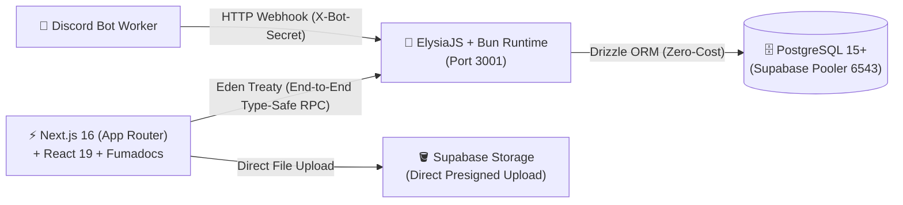
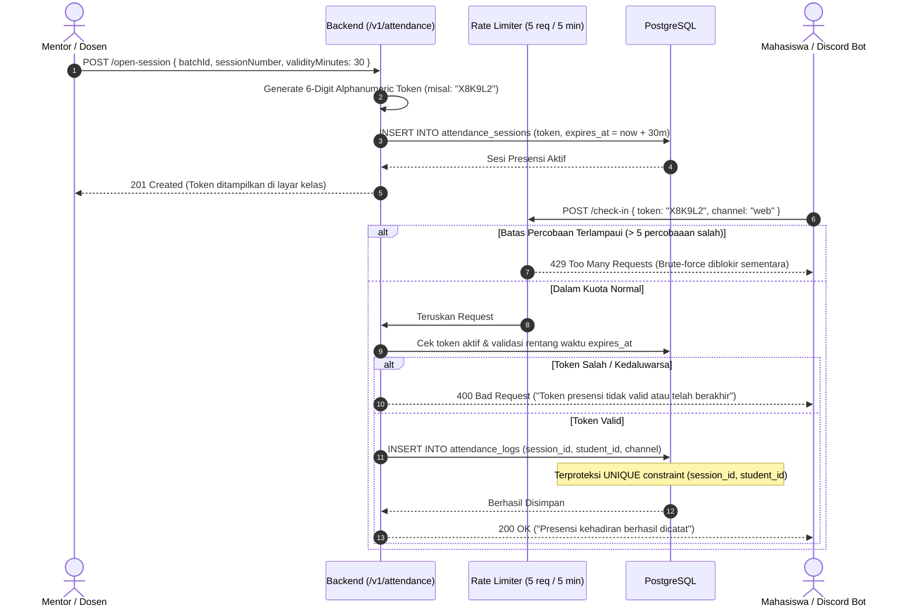
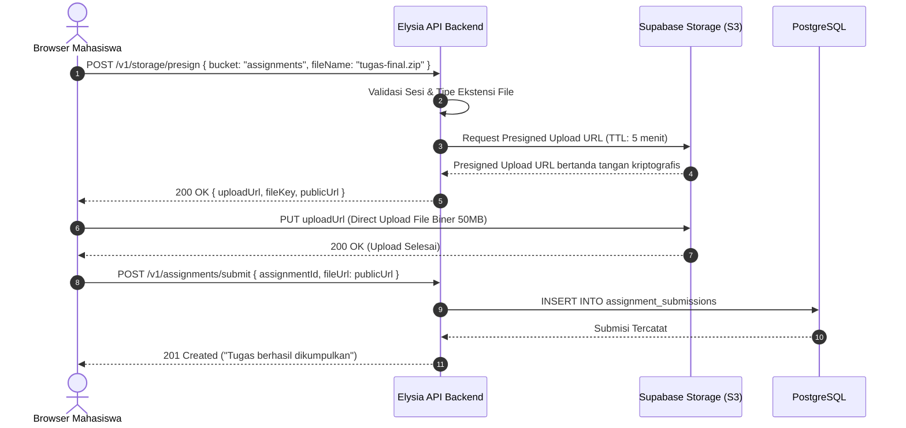

# 🏗️ Panduan Arsitektur Sistem Belajar Koding (SIAKAD & LMS)

Dokumen ini mendokumentasikan arsitektur sistem, topologi layer, alur logika bisnis, manajemen state, kontrak tipe *end-to-end*, keamanan sesi, serta strategi ketahanan (*security & resilience*) dan observabilitas pada platform **Belajar Koding**. Seluruh arsitektur disinkronisasikan secara penuh dengan blueprint database produksi di [DATABASE.md](file:///c:/Users/Fyy/Documents/Comission/Project/Web/belajar-koding/DATABASE.md).

---

## 1. Paradigma Arsitektur & Struktur Folder

### 1.1. Paradigma Arsitektur

Platform **Belajar Koding** dirancang menggunakan arsitektur **Decoupled Monorepo** yang memanfaatkan *Bun Workspaces*. Sistem memisahkan secara tegas tanggung jawab antara antarmuka pengguna (Frontend), layanan logika bisnis (Backend API), mesin konten dokumentasi (Fumadocs MDX Engine), media storage (Supabase Storage), dan integrasi pihak ketiga (Omnichannel Discord).



1. **Presentation & Content Layer (Frontend)**:
   - Dibangun dengan **Next.js 16 (App Router)** dan **React 19**.
   - Menyediakan antarmuka publik, portal civitas akademika (Mahasiswa, Mentor, Admin), serta dokumentasi kurikulum berbasis MDX interaktif menggunakan **Fumadocs**.
   - Menerapkan Server-Side Rendering (SSR) dan Server Components untuk proteksi rute terotentikasi, dikombinasikan dengan Client Components untuk interaktivitas dinamis.
   - Berkomunikasi dengan backend menggunakan **Elysia Eden Treaty** (`@elysiajs/eden`) untuk menjamin kepatuhan tipe data (*type safety*) secara *zero-codegen*.
2. **Pemisahan Sumber Kebenaran Konten Kurikulum (*Curriculum Boundary*)**:
   - **Fumadocs (`content/`) - Static Git-based**: Digunakan khusus untuk *Silabus Terbuka, Buku Pegangan Mahasiswa, dan Modul Panduan Mandiri*. Bersifat publik, di-version control langsung via repositori Git, dan dirender cepat dengan KaTeX math tanpa membebani database.
   - **Database (`course_materials`) - Dynamic Session-based**: Digunakan untuk *Materi Perkuliahan Dinamis, Slide Presentasi Dosen, Tautan Rekaman Kelas (Zoom/Meet), dan Lampiran Spesifik Batch*. Dikelola langsung oleh mentor/dosen per pertemuan sesi melalui portal SIAKAD.
3. **Application & Business Service Layer (Backend API)**:
   - Ditenagai oleh **Bun runtime** dan framework **ElysiaJS** (berjalan pada port `3001`).
   - Menyediakan kontrol autentikasi berbasis role (RBAC) via **Better-Auth** dengan cookie sesi `HttpOnly`, kalkulasi nilai akademik SIAKAD dengan bobot dinamis, manajemen presensi berbasis token OTP 6 digit, dan *webhook* integrasi bot Discord.
   - Seluruh endpoint dilindungi oleh layer validasi skema deklaratif (TypeBox) dan pembatas laju permintaan (*rate limiting*).
4. **Data Access & Persistence Layer**:
   - Menggunakan **PostgreSQL 15+** yang di-host di Supabase melalui *Transaction Pooler* (port `6543`) dengan mode `prepare: false`.
   - **Drizzle ORM** berperan sebagai jembatan *object-relational mapping* dengan skema produksi penuh (18 tabel relasional) yang menerapkan aturan `ON DELETE RESTRICT` pada entitas kritis dan mekanisme *soft delete* (`deleted_at`).
5. **Direct-to-Storage Layer (Presigned URLs)**:
   - Berkas berukuran besar (bukti transfer pendaftaran, arsip ZIP tugas, slide PDF materi) diunggah langsung dari browser ke **Supabase Storage** menggunakan *Presigned Upload URL* bertempo singkat (5 menit). Server Bun tidak memproses *multipart streaming* berkas biner besar, melindungi konsumsi RAM dan *event loop*.
6. **Omnichannel Integration Layer**:
   - Menghubungkan bot Discord dengan sistem akademik internal melalui protokol HTTP webhook terotentikasi (*shared secret* `X-Bot-Secret`).
   - Sistem secara otomatis mengunduh lampiran tugas dari Discord CDN ke Supabase Storage permanen untuk mencegah tautan kedaluwarsa akibat kebijakan retensi CDN Discord.

---

### 1.2. Struktur Folder & Tanggung Jawab Modul

```
belajar-koding/
├── src/                               # Frontend Next.js App Router
│   ├── app/                           # File-system routing Next.js
│   │   ├── (auth)/                    # Route Group autentikasi (login, register)
│   │   ├── (home)/                    # Landing page publik & etalase kursus
│   │   ├── api/                       # Internal route handlers (Fumadocs search)
│   │   ├── blog/                      # Publikasi blog & artikel teknologi
│   │   ├── dashboard/                 # Portal SIAKAD (Role: Student, Mentor, Admin)
│   │   │   ├── admin/                 # Manajemen batch, verifikasi bayar & pengguna
│   │   │   ├── dosen/                 # Manajemen kelas, materi, & penilaian mentor
│   │   │   ├── kelas/                 # Modul pembelajaran & materi per sesi mahasiswa
│   │   │   ├── khs/ & krs/            # Kartu Hasil Studi & Kartu Rencana Studi
│   │   │   ├── presensi/              # Presensi perkuliahan mahasiswa & mentor
│   │   │   └── assignments/           # Pengumpulan & evaluasi tugas
│   │   ├── docs/                      # Dokumentasi interaktif kurikulum (Fumadocs)
│   │   └── layout.tsx                 # Root layout aplikasi web
│   ├── components/                    # Reusable React UI Components
│   │   ├── dashboard/                 # Komponen khusus portal SIAKAD & sidebar tree
│   │   ├── docs-sidebar/              # Navigasi modul dokumentasi
│   │   ├── ui/                        # Desain sistem & komponen atomik (Shadcn/Base-UI)
│   │   └── theme-toggle.tsx           # Kontrol tema (Dark/Light mode)
│   ├── layouts/                       # Layout wrapper khusus (Notebook, Docs, Shared)
│   ├── hooks/                         # Custom hooks React (useMobile, useHighlightedCode)
│   └── lib/                           # Utilitas client-side & API client
│       ├── api.ts                     # Eden Treaty Client (treaty<App>)
│       ├── auth.ts                    # Utilitas sesi client & Better-Auth client
│       ├── courses.ts                 # Metadata kursus & katalog
│       └── dashboard-tree.tsx         # Generator pohon navigasi dinamis per peran
│
├── server/                            # Backend API Service (Bun + ElysiaJS)
│   ├── src/
│   │   ├── db/                        # Layer Database & Drizzle ORM
│   │   │   ├── schema.ts              # Definisi 18 tabel PostgreSQL & relasi Drizzle
│   │   │   ├── index.ts               # Inisialisasi koneksi postgres-js & Drizzle DB
│   │   │   ├── migrate-auth.ts        # Skrip migrasi tabel Better-Auth & Foreign Keys
│   │   │   ├── reset.ts               # Database cleaner & kurikulum seeder produksi
│   │   │   └── set-admin.ts           # Skrip elevasi peran administrator
│   │   ├── lib/                       # Utilitas bisnis server
│   │   │   ├── auth.ts                # Konfigurasi Better-Auth server engine
│   │   │   ├── grades.ts              # Kalkulator bobot dinamis & predikat SIAKAD
│   │   │   ├── supabase.ts            # Client Supabase Admin Storage (Presigned URL)
│   │   │   └── uuid.ts                # Generator & validator UUIDv7 berurutan
│   │   ├── middleware/                # Elysia plugins & scoped derivation
│   │   │   └── auth.ts                # Middleware resolusi sesi & profil pengguna
│   │   ├── routes/                    # Endpoint controller per domain modul
│   │   │   ├── auth.ts                # Endpoint login, register, profil, role sync
│   │   │   ├── profile.ts             # Manajemen biodata, avatar, discord linking
│   │   │   ├── batches.ts             # Pengelolaan batch, pendaftaran & verifikasi audit bayar
│   │   │   ├── classroom.ts           # Akses materi sesi terstruktur & course locking
│   │   │   ├── attendance.ts          # Pembukaan & klaim token presensi sesi (OTP)
│   │   │   ├── assignments.ts         # Publikasi penugasan & pengumpulan tugas
│   │   │   ├── grades.ts              # Rekapitulasi nilai & transkrip akademik KHS
│   │   │   └── bot.ts                 # Webhook Discord bot (presensi & submisi tugas)
│   │   └── index.ts                   # Entry point Elysia, CORS, Swagger, & export type App
│   ├── tests/                         # Unit & Integration tests (Bun test runner)
│   ├── drizzle.config.ts              # Konfigurasi Drizzle Kit CLI
│   └── package.json                   # Dependensi workspace server
│
├── content/                           # Konten dokumen silabus & kurikulum publik (MDX)
├── proxy.ts                           # URL rewrite negotiation untuk Markdown / LLMs
├── source.config.ts                   # Konfigurasi Fumadocs MDX loader & KaTeX math
└── package.json                       # Konfigurasi monorepo root & script orkestrasi
```

---

## 2. Diagram Komponen Arsitektur (Mermaid)

```mermaid
flowchart TD
    subgraph Klien["💻 Client & Omnichannel Clients"]
        Browser["🌐 Web Browser (Mahasiswa / Dosen / Admin)"]
        DiscordApp["💬 Discord Client (Mahasiswa)"]
        DiscordBotWorker["🤖 Discord Bot Worker"]
    end

    subgraph FrontendApp["⚡ Frontend Layer (Next.js 16 + React 19)"]
        direction TB
        AppRouter["App Router (/dashboard, /docs, /auth)"]
        ServerGuard["Server-Side Auth Guard (Server Component / Middleware)"]
        DashboardTree["Dynamic Dashboard Tree Generator"]
        EdenClient["Eden Treaty Client (treaty<App>)"]
        FumaEngine["Fumadocs MDX Engine + KaTeX Renderer"]
        StaticContent["content/ (Git Silabus & Handbook)"]

        AppRouter --> ServerGuard
        ServerGuard --> DashboardTree
        AppRouter --> FumaEngine
        FumaEngine -.->|Baca Statis| StaticContent
    end

    subgraph BackendApp["🦊 Backend API Layer (Bun + ElysiaJS Port 3001)"]
        direction TB
        RateLimiter["Rate Limiter Guard (@elysiajs/rate-limit)"]
        CorsMiddleware["CORS & Origin Whitelist Guard"]
        SwaggerDocs["Swagger OpenAPI Engine (/swagger)"]
        AuthDerive["Auth Plugin Derive Middleware (Session & Profile)"]
        
        subgraph Controllers["Route Controllers"]
            AuthRoute["/v1/auth (Register, Login, Password)"]
            ProfileRoute["/v1/profile (Biodata, Discord Pairing)"]
            ClassroomRoute["/v1/classroom (Sesi Materi, Course Lock)"]
            BatchRoute["/v1/batches (Batch, Verifikasi & Audit Bayar)"]
            AttendanceRoute["/v1/attendance (Token Presensi OTP)"]
            AssignmentRoute["/v1/assignments (Tugas & Submisi)"]
            GradeRoute["/v1/grades (SIAKAD Engine & Bobot Dinamis)"]
            BotRoute["/v1/bot (Webhook: Tautan, Presensi, Submisi)"]
        end

        subgraph BusinessServices["Layanan Bisnis & Domain Logic"]
            DynamicGradeCalc["Dynamic Grades Calculator (batch_courses weights)"]
            UUIDGen["UUIDv7 Generator"]
            BetterAuthEngine["Better-Auth Engine (HttpOnly Session)"]
            StoragePresigner["Supabase Presigned URL Signer"]
        end

        RateLimiter --> CorsMiddleware
        CorsMiddleware --> AuthDerive
        AuthDerive --> Controllers
        GradeRoute --> DynamicGradeCalc
        AuthRoute --> BetterAuthEngine
        Controllers --> UUIDGen
        Controllers --> StoragePresigner
    end

    subgraph Persistence["🗄️ Database & Storage Layer (Supabase)"]
        direction TB
        PostgresPooler["PostgreSQL 15+ (Transaction Pooler: 6543)"]
        DrizzleLayer["Drizzle ORM Engine (postgres-js, prepare: false)"]
        
        subgraph Tables["18 Skema Tabel Produksi"]
            AuthTables["user, session, account"]
            AcademicCore["profiles, courses, batches, batch_courses, batch_mentors"]
            EnrollmentAudit["batch_enrollments, enrollment_payments, certificates"]
            CurriculumDB["course_sessions, course_materials"]
            AttendanceDB["attendance_sessions, attendance_logs"]
            GradingDB["assignments, assignment_submissions, student_grades"]
            SystemDB["notifications, discord_pairing_codes"]
        end

        subgraph StorageBuckets["Supabase Storage S3 Buckets"]
            BucketAvatars["avatars/"]
            BucketPayments["payment-proofs/"]
            BucketAssignments["assignments/"]
            BucketMaterials["materials/"]
        end

        DrizzleLayer <--> PostgresPooler
        PostgresPooler --- Tables
    end

    %% Relasi Alur Komunikasi
    Browser <-->|HTTP / HTML / Server Action| AppRouter
    Browser <-->|Eden Treaty RPC (HttpOnly Cookie)| BackendApp
    Browser -.->|Direct-to-S3 Upload via Presigned URL| StorageBuckets
    DiscordApp <-->|Perintah Slash| DiscordBotWorker
    DiscordBotWorker -->|POST X-Bot-Secret| BotRoute
    BackendApp <-->|Drizzle Queries| DrizzleLayer
```

---

## 3. State Management, Service Flow & Business Logic Layer

### 3.1. Mekanisme State Management Frontend

Aplikasi mengeliminasi ketergantungan pada cookie peran klien yang rentan manipulasi dan beralih ke arsitektur **Zero-Trust Server-Side Session Validation**:

1. **HttpOnly Session Cookie**:
   - Token sesi dikelola sepenuhnya oleh **Better-Auth** menggunakan cookie dengan flag `HttpOnly; Secure; SameSite=Lax`.
   - JavaScript di sisi peramban (*client-side*) **tidak dapat** membaca nilai token sesi mentah, mengeliminasi risiko pencurian token melalui celah Cross-Site Scripting (XSS).
2. **Server-Side Role Verification (Anti-Privilege Escalation)**:
   - Next.js Server Components (`src/app/dashboard/layout.tsx`) dan `middleware.ts` tidak pernah mempercayai cookie peran mentah (`auth_role`) atau nilai dari `localStorage`.
   - Setiap rute terproteksi (`/dashboard/admin`, `/dashboard/dosen`) diverifikasi secara *server-side* langsung ke backend Elysia atau basis data sebelum halaman dirender. Percobaan mengubah nilai peran di DevTools browser tidak akan memiliki efek apa pun terhadap hak akses sistem.
3. **Optimistic Client Cache (Non-Sensitive UI State)**:
   - Informasi profil visual (nama tampilan, avatar URL) dapat di-cache secara lokal untuk mempercepat rendering antarmuka awal (*instant hydrate*).
   - Seluruh mutasi data dan aksi bernilai bisnis (pengumpulan tugas, pembukaan presensi, persetujuan pembayaran) wajib melewati validasi ulang di sisi backend Elysia.
4. **Dynamic Dashboard Tree State**:
   - Struktur bilah samping (*sidebar*) portal SIAKAD dihasilkan secara dinamis melalui [`dashboard-tree.tsx`](file:///c:/Users/Fyy/Documents/Comission/Project/Web/belajar-koding/src/lib/dashboard-tree.tsx).
   - Mahasiswa hanya memiliki akses navigasi ke batch aktif tempat mereka terdaftar dengan status `enrolled`. Sesi perkuliahan yang belum tiba tanggalnya otomatis terkunci (*session lock*).

---

### 3.2. Service Flow: Autentikasi & Otorisasi Pengguna

```mermaid
sequenceDiagram
    autonumber
    actor Pengguna as Pengguna (Browser)
    participant NextClient as Next.js Client
    participant NextServer as Next.js Server Component
    participant Elysia as Backend (/v1/auth)
    participant BetterAuth as Better-Auth Engine
    participant DB as PostgreSQL (Drizzle)

    Pengguna->>NextClient: Input Email & Password (Form Login)
    NextClient->>Elysia: POST /v1/auth/login via Eden Treaty
    Elysia->>BetterAuth: Validasi Kredensial (Argon2id Hash)
    BetterAuth->>DB: Query tabel user & account
    DB-->>BetterAuth: Kredensial Valid
    BetterAuth->>DB: Insert record ke tabel session
    DB-->>BetterAuth: Sesi Terbuat
    BetterAuth-->>Elysia: Sesi Aktif
    Elysia-->>NextClient: Set-Cookie: better-auth.session_token (HttpOnly; Secure; SameSite=Lax)<br/>+ Body: { success: true, user }
    NextClient->>Pengguna: Navigasi ke /dashboard
    
    Pengguna->>NextServer: Request /dashboard/admin
    NextServer->>Elysia: GET /v1/auth/me (Forwarding HttpOnly Cookie)
    Elysia->>DB: Query user LEFT JOIN profiles
    DB-->>Elysia: Data user (role: 'student')
    Elysia-->>NextServer: 200 OK { user: { role: 'student' } }
    NextServer-->>Pengguna: 403 Forbidden / Redirect ke /dashboard/kelas
```

---

### 3.3. Service Flow: Logika Bisnis Penilaian Akademik SIAKAD

Logika evaluasi akademik pada [`grades.ts`](file:///c:/Users/Fyy/Documents/Comission/Project/Web/belajar-koding/server/src/lib/grades.ts) mendukung **konfigurasi bobot dinamis per kurikulum kursus** yang dikaitkan pada tabel pivot `batch_courses`:

1. **Formula Pembobotan Dinamis**:
   $$\text{Final Score} = (S_{\text{assignments}} \times w_{\text{assignments}}) + (S_{\text{quizzes}} \times w_{\text{quizzes}}) + (S_{\text{uts}} \times w_{\text{uts}}) + (S_{\text{uas}} \times w_{\text{uas}}) + (S_{\text{attendance}} \times w_{\text{attendance}})$$

   Dengan batasan integritas basis data:
   $$w_{\text{assignments}} + w_{\text{quizzes}} + w_{\text{uts}} + w_{\text{uas}} + w_{\text{attendance}} = 100.00\%$$
   *(Konfigurasi baku: Tugas 20%, Kuis 20%, UTS 30%, UAS 30%, Presensi 0% — dapat diatur secara mandiri oleh mentor/admin per kursus).*

2. **Dukungan Mahasiswa Mengulang (*Repeat Students*)**:
   - Nilai akhir disimpan pada tabel `student_grades` yang terikat pada pasangan foreign key `(enrollment_id, batch_course_id)`.
   - Jika mahasiswa mengulang mata kuliah yang sama di batch berikutnya, histori nilai batch lama tetap utuh dan terisolasi dari batch baru.

3. **Tabel Standar Konversi Mutu & Indeks Prestasi**:
   | Rentang Skor Akhir | Huruf Mutu | Bobot Indeks | Predikat Akademik | Status Kelulusan |
   | :--- | :---: | :---: | :--- | :---: |
   | $\ge 85.00$ | **A** | `4.0` | Sangat Baik (*Distinction*) | **Lulus** |
   | $75.00 - 84.99$ | **B** | `3.0` | Baik (*Good*) | **Lulus** |
   | $65.00 - 74.99$ | **C** | `2.0` | Cukup (*Satisfactory*) | **Lulus** |
   | $50.00 - 64.99$ | **D** | `1.0` | Kurang (*Poor*) | **Tidak Lulus** |
   | $< 50.00$ | **E** | `0.0` | Gagal (*Failed*) | **Tidak Lulus** |

4. **Pemberian Nilai Override & Penerbitan Sertifikat**:
   - Jika mentor melakukan penyesuaian nilai manual, flag `is_override = true` diaktifkan beserta pencatatan ID penilai (`graded_by`) dan waktu penilaian (`graded_at`).
   - Apabila nilai akhir $\ge 65.00$ (*Passing Grade*), sistem mengaktifkan kelayakan penerbitan sertifikat kelulusan digital pada tabel `certificates` lengkap dengan nomor seri unik (`BK-CERT-YYYY-XXXXX`).

---

### 3.4. Service Flow: Presensi Terbatas Token (OTP) dengan Proteksi Brute-Force



---

### 3.5. Service Flow: Integrasi Omnichannel Discord Bot

1. **Penautan Akun (Handshake Pairing)**:
   - Mahasiswa meminta kode pairing melalui antarmuka web `/dashboard/profil`.
   - Sistem menerbitkan kode 6 karakter dengan masa aktif 15 menit ke tabel `discord_pairing_codes`.
   - Mahasiswa mengetik `/tautkan <kode>` di server Discord Belajar Koding.
   - Worker Discord memanggil endpoint `POST /v1/bot/link-discord` dengan menyertakan header `X-Bot-Secret`.
   - Backend memverifikasi masa aktif kode, menyimpan `discord_id` dan `discord_username` langsung ke tabel `user` (*Single Source of Truth*), lalu menghapus kode pairing tersebut (*single-use*).
2. **Penyerahan Tugas & Preservasi Berkas Discord CDN**:
   - Mahasiswa mengumpulkan tugas melalui thread penugasan Discord.
   - Bot Discord memanggil endpoint webhook `POST /v1/bot/submission`.
   - **Pencegahan Tautan Kedaluwarsa (Discord CDN Expiration)**: Karena URL attachment Discord memiliki signature kedaluwarsa (24 jam), worker backend mengunduh berkas dari CDN Discord lalu mengunggahnya langsung ke Supabase Storage bucket `assignments/`.
   - URL permanen Supabase Storage disimpan ke tabel `assignment_submissions` dengan status `submitted_via: 'discord'`.

---

## 4. Error Handling & Kontrak Komunikasi

### 4.1. Strategi Penanganan Kesalahan (*Error Handling*)

Sistem menerapkan prinsip *fail-fast* dan *structured response contract* di seluruh boundary API:

#### 1. Kontrak Respons JSON Baku
```typescript
// Respons Berhasil (Single Entity)
{
  "success": true,
  "message": "Operasi berhasil diselesaikan.",
  "data": { ... }
}

// Respons Berhasil (List Entity dengan Pagination)
{
  "success": true,
  "message": "Data berhasil diambil.",
  "data": [ ... ],
  "meta": {
    "page": 1,
    "limit": 20,
    "total": 142,
    "totalPages": 8
  }
}

// Respons Gagal / Kesalahan
{
  "success": false,
  "message": "Pesan deskriptif kesalahan yang dapat dipahami pengguna.",
  "error": "ERR_VALIDATION_FAILED" // Opsional: Kode error terstandarisasi
}
```

#### 2. Konvensi Status HTTP Semantik
- **`200 OK`**: Permintaan pengambilan data (GET) atau pembaruan (PATCH/PUT) berhasil.
- **`201 Created`**: Sumber daya baru berhasil dibuat di database (registrasi user, pendaftaran batch, pembuatan tugas, penyerahan tugas).
- **`400 Bad Request`**: Validasi skema gagal (skor di luar 0-100, password terlalu pendek, token presensi kedaluwarsa).
- **`401 Unauthorized`**: Sesi autentikasi tidak ditemukan, token Bearer kedaluwarsa, atau header `X-Bot-Secret` salah.
- **`403 Forbidden`**: Pengguna sah terotentikasi namun tidak memiliki wewenang untuk sumber daya terkait (misal: mahasiswa mengakses manajemen batch admin).
- **`404 Not Found`**: Kursus, batch, atau ID submisi tidak ditemukan dalam basis data.
- **`429 Too Many Requests`**: Pembatas laju permintaan (*rate limit*) terpicu akibat percobaan akses berlebih.
- **`500 Internal Server Error`**: Kegagalan internal backend yang tidak tertangani secara terduga.

---

## 5. End-to-End Type Safety & Kontrak Komunikasi (Eden Treaty)

Karena proyek menggunakan struktur **Bun Monorepo**, komunikasi antara Next.js (Frontend) dan ElysiaJS (Backend) tidak menggunakan `fetch` manual yang rentan salah ketik, melainkan **Elysia Eden Treaty** (`@elysiajs/eden`).

### 5.1. Zero-Codegen Type Sharing

1. **Ekspor Tipe Server**:
   Pada [`server/src/index.ts`](file:///c:/Users/Fyy/Documents/Comission/Project/Web/belajar-koding/server/src/index.ts), instance aplikasi diekspor sebagai tipe:
   ```typescript
   export const app = new Elysia()
     // ... plugins & routes
     .listen(port);

   export type App = typeof app;
   ```

2. **Konsumsi Tipe di Frontend**:
   Frontend menginisialisasi klien Eden Treaty di [`src/lib/api.ts`](file:///c:/Users/Fyy/Documents/Comission/Project/Web/belajar-koding/src/lib/api.ts):
   ```typescript
   import { treaty } from '@elysiajs/eden';
   import type { App } from '../../../server/src';

   const API_URL = process.env.NEXT_PUBLIC_API_URL || 'http://localhost:3001';

   // Eden Treaty client dengan credential cookie otomatis
   export const api = treaty<App>(API_URL, {
     fetch: {
       credentials: 'include',
     },
   });
   ```

3. **Keuntungan Teknis**:
   - **Autocompletion Penuh**: Seluruh rute, metode HTTP, skema request body, query parameter, dan tipe kembalian terdeteksi otomatis di IDE editor.
   - **Pencegahan Regresi**: Jika ada perubahan nama kolom atau parameter di controller Elysia, proses build Next.js (`bun run build` / `tsc`) akan langsung mendeteksi galat sebelum kode masuk ke produksi.

---

### 5.2. Alur Upload Berkas Langsung (Presigned URL Pattern)

Untuk menjaga stabilitas memori proses Bun dan mencegah pemborosan bandwidth server, berkas biner besar **tidak pernah** dialirkan melewati body request Elysia.



---

## 6. Arsitektur Keamanan & Ketahanan Sistem (Security & Resilience)

### 6.1. Keamanan Sesi & Pencegahan Privilege Escalation

- **HttpOnly Cookie**: Token sesi utama disimpan menggunakan atribut `HttpOnly; Secure; SameSite=Lax` untuk mencegah pencurian token melalui serangan XSS.
- **Server-Side Role Verification**: Middleware Next.js (`middleware.ts`) dan Server Components tidak pernah mengandalkan nilai peran dari `localStorage` atau cookie non-terverifikasi untuk otorisasi halaman sensitif (`/dashboard/admin` dan `/dashboard/dosen`). Setiap akses divalidasi terhadap sesi aktif di backend.
- **Session Revocation on Password Change**: Ketika pengguna mengganti password melalui `PATCH /v1/auth/password`, backend mewajibkan input `currentPassword` dan secara otomatis memusnahkan (*revoke*) seluruh sesi aktif lain di tabel `session`.

---

### 6.2. Rate Limiting & Proteksi Brute-Force

Sistem menerapkan pembatasan laju permintaan (*rate limiting*) menggunakan plugin `@elysiajs/rate-limit` pada endpoint-endpoint rawan serangan:

| Endpoint | Batas Maksimum | Jendela Waktu | Tujuan Proteksi |
| :--- | :---: | :---: | :--- |
| `POST /v1/auth/login` | 5 request / IP | 1 menit | Mencegah *credential stuffing* & *brute-force* password. |
| `POST /v1/auth/register` | 3 request / IP | 5 menit | Mencegah spam pembuatan akun palsu secara massal. |
| `POST /v1/attendance/check-in` | 5 request / User | 5 menit | Mencegah *brute-force* tebakan 6 digit token presensi OTP. |
| `POST /v1/profile/discord/pair` | 3 request / User | 15 menit | Mencegah *spamming* penerbitan kode pairing Discord. |
| `POST /v1/bot/*` | 60 request / IP | 1 menit | Mencegah *flooding* lalu lintas pada webhook Discord. |

---

### 6.3. Structured Logging & Request Tracing

1. **Request Tracing ID**:
   - Setiap HTTP request yang masuk ke Elysia diinjeksi header pelacak unik:
     ```http
     X-Request-ID: 018f3a5b-9d41-7e82-bc14-8f0a61234567
     ```
   - ID ini dibangkitkan menggunakan format **UUIDv7** berurutan menurut waktu dan diteruskan ke setiap log serta respons kesalahan untuk memudahkan penelusuran masalah (*root cause analysis*).

2. **JSON Terstruktur (Pino Engine)**:
   - Di lingkungan produksi, pencatatan log diformat dalam struktur JSON standar:
     ```json
     {
       "level": "info",
       "time": "2026-10-24T12:00:00.123Z",
       "requestId": "018f3a5b-9d41-7e82-bc14-8f0a61234567",
       "userId": "018f3a5b-7890-7abc-def0-123456789abc",
       "method": "POST",
       "path": "/v1/attendance/check-in",
       "status": 200,
       "durationMs": 14.2
     }
     ```
   - Log tingkat produksi disaring ketat agar tidak mencatat kredensial rahasia, *hashed passwords*, token otentikasi, atau *shared bot secrets*.

---

### 6.4. Proteksi Integritas Relasional & Soft Delete

Sesuai dengan blueprint [DATABASE.md](file:///c:/Users/Fyy/Documents/Comission/Project/Web/belajar-koding/DATABASE.md):
- **Eliminasi Dual Source of Truth**: Tabel `user` bertindak sebagai *Single Source of Truth* untuk autentikasi, status akun, peran, dan identitas Discord. Tabel `profiles` murni menyimpan biodata akademik.
- **Proteksi Hapus Kritis (`ON DELETE RESTRICT`)**: Mencegah penghapusan tak sengaja (*accidental delete*) pada entitas induk (`courses`, `batches`) yang dapat memusnahkan histori nilai dan sertifikat mahasiswa.
- **Audit Finansial Terpisah**: Setiap pembayaran mahasiswa dicatat secara independen di tabel `enrollment_payments` sehingga histori penolakan atau revisi transfer tetap terekam untuk keperluan audit keuangan.
- **Soft Deletes**: Seluruh entitas utama mengimplementasikan kolom `deleted_at` bertipe `timestamp with time zone` untuk memastikan data yang dihapus dapat dipulihkan jika terjadi kesalahan operasional manusia.
