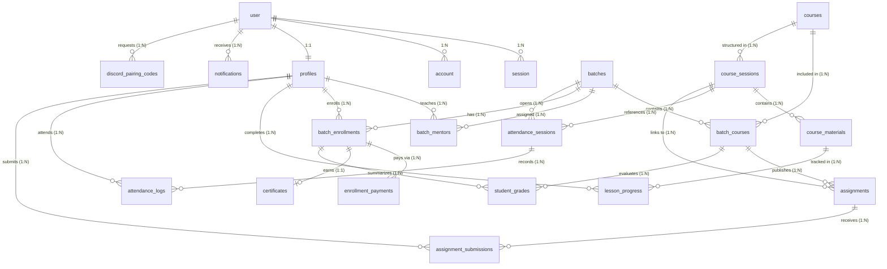

# 🗄️ Dokumentasi & Blueprint Database SIAKAD (100% Production-Grade)

Dokumen ini merupakan spesifikasi teknis dan arsitektur database relasional platform **Belajar Koding** (Sistem Informasi Akademik & LMS berbasis Full-Stack) dengan standar **100% Production-Ready**. 

Arsitektur ini dirancang untuk tahan terhadap kesalahan operasional (*accidental delete*), mendukung audit keuangan lengkap, menghilangkan *dual source of truth*, fleksibel terhadap perubahan bobot kurikulum, serta siap menangani penerbitan sertifikat kelulusan digital publik.

---

## 1. Overview Database

| Aspek | Spesifikasi | Keterangan |
| :--- | :--- | :--- |
| **Database Engine** | **PostgreSQL 15+** | Di-host pada Supabase dengan Transaction Connection Pooling (port `6543`) & Direct Connection (port `5432`). |
| **Object-Relational Mapping (ORM)** | **Drizzle ORM** (`drizzle-orm` v0.39+) | Driver `postgres` (`postgres-js`), performa tinggi dengan native TypeScript type-safety. |
| **Migration Tooling** | **Drizzle Kit** (`drizzle-kit` v0.30+) | Dikelola melalui perintah `bun run db:push`, `bun run db:studio`, dan skrip migrasi TypeScript. |
| **Primary Key Strategy** | **UUIDv7 & Text ID** | UUIDv7 (time-ordered, terurut kronologis) digunakan pada seluruh entitas akademik untuk eliminasi fragmentasi B-Tree. Format string ID digunakan pada Better-Auth & Profiles. |
| **Naming Conventions** | **snake_case (DB) / camelCase (TS)** | Tabel jamak (`courses`, `batches`, `student_grades`) untuk entitas domain dan tunggal (`user`, `session`, `account`, `verification`) untuk standar Better-Auth. Kolom DB menggunakan `snake_case`. |
| **Integritas Referensial** | **`RESTRICT` & Soft Delete** | Mencegah penghapusan tidak sengaja (*accidental cascade deletion*) pada data histori nilai, transaksi pendaftaran, dan kurikulum aktif. |
| **Audit Keuangan** | **`enrollment_payments` Terpisah** | Mendukung histori penolakan bukti bayar, pengunggahan ulang, dan verifikasi multi-step admin. |
| **Integrasi Omnichannel** | **Discord Bot & Notifikasi Terpusat** | Tabel `notifications` multi-channel (In-App & Discord DM) serta `discord_pairing_codes` untuk verifikasi akun instan. |

---

## 2. Perombakan Arsitektur Kunci (Dari 85% ke 100%)

1. **Eliminasi Dual Source of Truth (`batches` & `profiles`)**:
   - Menghapus kolom `course_id` dan `mentor_id` langsung dari tabel `batches`. Seluruh relasi kurikulum dan pengajar dikelola murni melalui tabel pivot `batch_courses` (dengan bobot penilaian dinamis) dan `batch_mentors` (dengan flag *lead mentor* vs *assistant*).
   - Menghapus duplikasi kolom `email`, `role`, `discord_id`, dan `discord_username` antara `user` dan `profiles`. Tabel `user` bertindak sebagai *Single Source of Truth* identitas autentikasi, sedangkan `profiles` fokus pada atribut akademik/biodata (`nim`, `phone_number`, `github_username`, `bio`).

2. **Proteksi Data Kritis (`RESTRICT` & Soft Delete)**:
   - Mengganti `ON DELETE CASCADE` menjadi `ON DELETE RESTRICT` pada entitas vital (`courses`, `batches`, `student_grades`, `batch_enrollments`) serta menambahkan kolom `deleted_at` (*soft delete*) pada tabel `batches`. Admin tidak dapat secara tidak sengaja menghapus seluruh histori nilai dan presensi satu angkatan hanya karena menghapus baris kursus.

3. **Pemisahan Tabel Transaksi Keuangan (`enrollment_payments`)**:
   - Memisahkan log pembayaran dari `batch_enrollments`. Jika bukti transfer pertama ditolak admin dan calon siswa mengunggah ulang bukti baru, histori penolakan dan alasan sebelumnya tetap tercatat untuk audit keuangan.

4. **Fleksibilitas Bobot Nilai & Kehadiran**:
   - Konfigurasi persentase penilaian dinamis per kursus/batch disimpan di `batch_courses` (`weight_attendance`, `weight_tugas`, `weight_quiz`, `weight_uts`, `weight_uas`, `passing_score`) dengan *check constraint* total bobot 100%. Komponen `attendance_score` dan status `is_passed` dicatat resmi di `student_grades`.

5. **Kelengkapan Siklus LMS (`certificates` & `notifications`)**:
   - Menambahkan tabel penerbitan sertifikat kelulusan digital ber-nomor seri unik publik (`certificates`) dengan fitur verifikasi dan pencabutan (*revoke*), serta sistem notifikasi terpusat (`notifications`) yang mendukung flag pengiriman Discord bot.

6. **Normalisasi Foreign Key (`lesson_progress`)**:
   - Mengubah referensi `course_slug` / `lesson_slug` menjadi FK berbasis UUID ke `course_materials(id)` agar jika judul atau slug modul diubah oleh mentor di kemudian hari, progres belajar siswa tidak hilang (*orphaned*).

---

## 3. Diagram ERD Produksi (Mermaid)



---

## 4. Rincian Tabel & Koleksi

### 4.1. Modul Autentikasi & Identitas

#### A. Tabel `user` (Better-Auth Single Source of Truth)
Tabel inti identitas pengguna yang dikelola langsung oleh engine Better-Auth.
- **Tanggung Jawab**: Manajemen user credentials, OAuth provider identity, status verifikasi email, role otorisasi global, dan identitas Discord.

| Field | Type | Nullable | Default | Keterangan |
| :--- | :--- | :---: | :--- | :--- |
| `id` | `text` | ❌ No | *(Auto)* | Primary Key unik akun pengguna (Better-Auth string ID). |
| `name` | `text` | ❌ No | - | Nama tampilan akun pengguna. |
| `email` | `text` | ❌ No | - | Alamat email unik untuk login & verifikasi. |
| `email_verified` | `boolean` | ❌ No | `false` | Status verifikasi email. |
| `image` | `text` | ✅ Yes | `NULL` | URL avatar default profil akun. |
| `role` | `text` | ✅ Yes | `'student'` | Role global akun: `'student'`, `'mentor'`, `'admin'`. |
| `discord_id` | `text` | ✅ Yes | `NULL` | ID unik akun Discord (Snowflake) pengguna. |
| `discord_username` | `text` | ✅ Yes | `NULL` | Username handle Discord pengguna. |
| `created_at` | `timestamptz` | ❌ No | `now()` | Waktu registrasi akun (UTC). |
| `updated_at` | `timestamptz` | ❌ No | `now()` | Waktu pembaruan akun terakhir. |

#### B. Tabel `session`
Menyimpan sesi login aktif pengguna pada peramban web maupun sesi API.

| Field | Type | Nullable | Default | Keterangan |
| :--- | :--- | :---: | :--- | :--- |
| `id` | `text` | ❌ No | *(Auto)* | Primary Key sesi. |
| `expires_at` | `timestamptz` | ❌ No | - | Waktu kedaluwarsa sesi autentikasi. |
| `token` | `text` | ❌ No | - | Token sesi unik (disimpan pada HttpOnly cookie). |
| `ip_address` | `text` | ✅ Yes | `NULL` | Alamat IP klien saat login. |
| `user_agent` | `text` | ✅ Yes | `NULL` | User agent browser / perangkat. |
| `user_id` | `text` | ❌ No | - | FK ke `user(id)` (`ON DELETE CASCADE`). |
| `created_at` | `timestamptz` | ❌ No | `now()` | Waktu inisiasi sesi. |
| `updated_at` | `timestamptz` | ❌ No | `now()` | Waktu sesi terakhir diakses. |

#### C. Tabel `account`
Menyimpan kredensial otentikasi pihak ketiga (Google OAuth, GitHub) dan password lokal terenkripsi.

| Field | Type | Nullable | Default | Keterangan |
| :--- | :--- | :---: | :--- | :--- |
| `id` | `text` | ❌ No | *(Auto)* | Primary Key akun tautan. |
| `account_id` | `text` | ❌ No | - | ID sub dari provider OAuth eksternal. |
| `provider_id` | `text` | ❌ No | - | Identifier provider (`'credential'`, `'google'`, `'github'`). |
| `user_id` | `text` | ❌ No | - | FK ke `user(id)` (`ON DELETE CASCADE`). |
| `access_token` | `text` | ✅ Yes | `NULL` | Access token OAuth. |
| `refresh_token` | `text` | ✅ Yes | `NULL` | Refresh token OAuth. |
| `id_token` | `text` | ✅ Yes | `NULL` | OpenID Connect token jika tersedia. |
| `access_token_expires_at` | `timestamptz` | ✅ Yes | `NULL` | Masa berlaku access token. |
| `refresh_token_expires_at`| `timestamptz` | ✅ Yes | `NULL` | Masa berlaku refresh token. |
| `scope` | `text` | ✅ Yes | `NULL` | Cakupan izin OAuth yang diberikan. |
| `password` | `text` | ✅ Yes | `NULL` | Hash password (Argon2id / Scrypt via Better-Auth). |
| `created_at` | `timestamptz` | ❌ No | `now()` | Waktu pembuatan entri akun. |
| `updated_at` | `timestamptz` | ❌ No | `now()` | Waktu perubahan kredensial akun. |

#### D. Tabel `verification`
Penyimpanan token sementara untuk verifikasi email, reset password, dan magic link.

| Field | Type | Nullable | Default | Keterangan |
| :--- | :--- | :---: | :--- | :--- |
| `id` | `text` | ❌ No | *(Auto)* | Primary Key unik token. |
| `identifier` | `text` | ❌ No | - | Identifier target (alamat email pengguna). |
| `value` | `text` | ❌ No | - | Token rahasia hash verifikasi. |
| `expires_at` | `timestamptz` | ❌ No | - | Waktu kedaluwarsa token. |
| `created_at` | `timestamptz` | ❌ No | `now()` | Waktu token dibuat. |
| `updated_at` | `timestamptz` | ❌ No | `now()` | Waktu pembaruan status token. |

#### E. Tabel `profiles` (Bebas Redundansi Data)
Profil bisnis domain akademik dan biodata resmi. **Tidak lagi menduplikasi** `email`, `role`, `discord_id`, atau `discord_username` dari tabel `user` untuk mengeliminasi *data drift*.

| Field | Type | Nullable | Default | Keterangan |
| :--- | :--- | :---: | :--- | :--- |
| `id` | `text` | ❌ No | - | PK & FK ke `user(id)` (`ON DELETE CASCADE`). |
| `nim` | `text` | ✅ Yes | `NULL` | **Nomor Induk Siswa/Peserta unik** (contoh: `BK-2026-0012`). |
| `full_name` | `text` | ❌ No | - | Nama lengkap resmi untuk transkrip & pencetakan sertifikat. |
| `phone_number` | `text` | ✅ Yes | `NULL` | Nomor kontak WhatsApp aktif peserta. |
| `github_username` | `text` | ✅ Yes | `NULL` | Username GitHub untuk validasi otomatis repository tugas. |
| `bio` | `text` | ✅ Yes | `NULL` | Deskripsi singkat / profil ringkas siswa atau mentor. |
| `avatar_url` | `text` | ✅ Yes | `NULL` | URL avatar kustom jika berbeda dari provider OAuth. |
| `created_at` | `timestamptz` | ❌ No | `now()` | Waktu profil pertama kali diinisialisasi. |
| `updated_at` | `timestamptz` | ❌ No | `now()` | Waktu pembaruan data biodata terakhir. |

---

### 4.2. Modul Kurikulum & Silabus

#### A. Tabel `courses`
Daftar mata kuliah atau program kurikulum utama.

| Field | Type | Nullable | Default | Keterangan |
| :--- | :--- | :---: | :--- | :--- |
| `id` | `uuid` | ❌ No | `uuidv7()` | Primary Key (UUIDv7). |
| `slug` | `text` | ❌ No | - | Slug unik ramah SEO (contoh: `fullstack-web-pro`). |
| `title` | `text` | ❌ No | - | Judul resmi mata kuliah / kurikulum. |
| `description` | `text` | ✅ Yes | `NULL` | Deskripsi silabus dan capaian kompetensi. |
| `total_sessions` | `integer` | ❌ No | `16` | Jumlah pertemuan standar dalam satu semester. |
| `created_at` | `timestamptz` | ❌ No | `now()` | Waktu kurikulum dibuat. |

#### B. Tabel `course_sessions`
Rincian setiap pertemuan terstruktur (Pertemuan 1 hingga 16) dari suatu kurikulum.

| Field | Type | Nullable | Default | Keterangan |
| :--- | :--- | :---: | :--- | :--- |
| `id` | `uuid` | ❌ No | `uuidv7()` | Primary Key (UUIDv7). |
| `course_id` | `uuid` | ❌ No | - | FK ke `courses(id)` (`ON DELETE RESTRICT`). |
| `session_number` | `integer` | ❌ No | - | Nomor urut pertemuan (1, 2, ..., 16). |
| `title` | `text` | ❌ No | - | Judul topik materi pertemuan. |
| `description` | `text` | ✅ Yes | `NULL` | Rincian target pembelajaran sesi. |
| `order_index` | `integer` | ❌ No | `0` | Urutan tampilan sesi. |
| `created_at` | `timestamptz` | ❌ No | `now()` | Waktu pembuatan sesi. |
| `updated_at` | `timestamptz` | ❌ No | `now()` | Waktu pembaruan topik sesi. |

> **Unique Constraint**: `(course_id, session_number)`

#### C. Tabel `course_materials`
Modul bacaan, materi ajar pendukung, dan lampiran berkas pertemuan.

| Field | Type | Nullable | Default | Keterangan |
| :--- | :--- | :---: | :--- | :--- |
| `id` | `uuid` | ❌ No | `uuidv7()` | Primary Key (UUIDv7). |
| `session_id` | `uuid` | ❌ No | - | FK ke `course_sessions(id)` (`ON DELETE CASCADE`). |
| `mentor_id` | `text` | ❌ No | - | FK ke `profiles(id)` penyusun materi (`ON DELETE RESTRICT`). |
| `title` | `text` | ❌ No | - | Judul materi ajar. |
| `content_mdx` | `text` | ❌ No | - | Konten teks lengkap materi pembelajaran dalam format MDX. |
| `file_url` | `text` | ✅ Yes | `NULL` | URL berkas lampiran pendukung (slide/PDF di Supabase Storage). |
| `order_index` | `integer` | ❌ No | `0` | Urutan bacaan materi dalam satu pertemuan. |
| `created_at` | `timestamptz` | ❌ No | `now()` | Waktu materi diunggah. |
| `updated_at` | `timestamptz` | ❌ No | `now()` | Waktu materi diperbarui. |

---

### 4.3. Modul Batch, Pendaftaran & Keuangan

#### A. Tabel `batches` (Clean Relation & Soft Delete)
Angkatan kelas yang dibuka. `course_id` dan `mentor_id` **dihapus** karena seluruh relasi dikelola secara bersih melalui tabel relasi `batch_courses` dan `batch_mentors`.

| Field | Type | Nullable | Default | Keterangan |
| :--- | :--- | :---: | :--- | :--- |
| `id` | `uuid` | ❌ No | `uuidv7()` | Primary Key (UUIDv7). |
| `code` | `text` | ❌ No | - | **Kode unik batch** (contoh: `FSW-B01`). |
| `name` | `text` | ❌ No | - | Nama angkatan kelas (contoh: `Full-Stack Web Batch 1`). |
| `description` | `text` | ✅ Yes | `NULL` | Deskripsi atau jadwal pelaksanaan batch. |
| `price` | `numeric(12,2)` | ❌ No | `0.00` | Biaya pendaftaran dalam mata uang Rupiah. |
| `payment_account_info` | `text` | ✅ Yes | `NULL` | Informasi nomor rekening bank / instruksi pembayaran. |
| `max_students` | `integer` | ❌ No | `30` | Kuota daya tampung maksimum siswa. |
| `enrolled_count` | `integer` | ❌ No | `0` | **Counter siswa aktif** (mencegah *race condition* kuota). |
| `status` | `batch_status` | ❌ No | `'draft'` | Enum: `'draft'`, `'open'`, `'ongoing'`, `'completed'`, `'archived'`. |
| `start_date` | `timestamptz` | ✅ Yes | `NULL` | Tanggal perkuliahan dimulai. |
| `end_date` | `timestamptz` | ✅ Yes | `NULL` | Tanggal perkuliahan selesai / kelulusan. |
| `deleted_at` | `timestamptz` | ✅ Yes | `NULL` | **Stempel soft delete** (penghapusan aman non-destruktif). |
| `created_at` | `timestamptz` | ❌ No | `now()` | Waktu batch dibuat. |
| `updated_at` | `timestamptz` | ❌ No | `now()` | Waktu batch diperbarui. |

#### B. Tabel `batch_courses` (Konfigurasi Bobot Nilai Dinamis)
Pivot kurikulum yang diajarkan pada suatu batch dengan konfigurasi persentase penilaian dinamis.

| Field | Type | Nullable | Default | Keterangan |
| :--- | :--- | :---: | :--- | :--- |
| `id` | `uuid` | ❌ No | `uuidv7()` | Primary Key (UUIDv7). |
| `batch_id` | `uuid` | ❌ No | - | FK ke `batches(id)` (`ON DELETE RESTRICT`). |
| `course_id` | `uuid` | ❌ No | - | FK ke `courses(id)` (`ON DELETE RESTRICT`). |
| `weight_attendance` | `numeric(5,2)` | ❌ No | `10.00` | Bobot presensi kehadiran (default: 10%). |
| `weight_tugas` | `numeric(5,2)` | ❌ No | `20.00` | Bobot rata-rata tugas (default: 20%). |
| `weight_quiz` | `numeric(5,2)` | ❌ No | `20.00` | Bobot rata-rata kuis (default: 20%). |
| `weight_uts` | `numeric(5,2)` | ❌ No | `20.00` | Bobot evaluasi UTS (default: 20%). |
| `weight_uas` | `numeric(5,2)` | ❌ No | `30.00` | Bobot evaluasi UAS / Capstone (default: 30%). |
| `passing_score` | `numeric(5,2)` | ❌ No | `70.00` | Batas nilai kelulusan minimum (KKM). |
| `created_at` | `timestamptz` | ❌ No | `now()` | Waktu penautan kurikulum ke batch. |

> **Check Constraint**: `CHECK (weight_attendance + weight_tugas + weight_quiz + weight_uts + weight_uas = 100.00)`  
> **Unique Index**: `(batch_id, course_id)`

#### C. Tabel `batch_mentors` (Peran Pengajar Spesifik)
Menghubungkan mentor dan asisten mentor dengan angkatan batch.

| Field | Type | Nullable | Default | Keterangan |
| :--- | :--- | :---: | :--- | :--- |
| `id` | `uuid` | ❌ No | `uuidv7()` | Primary Key (UUIDv7). |
| `batch_id` | `uuid` | ❌ No | - | FK ke `batches(id)` (`ON DELETE CASCADE`). |
| `mentor_id` | `text` | ❌ No | - | FK ke `profiles(id)` (`ON DELETE RESTRICT`). |
| `is_lead` | `boolean` | ❌ No | `false` | `true` untuk Mentor Utama, `false` untuk Asisten Mentor. |
| `created_at` | `timestamptz` | ❌ No | `now()` | Waktu penugasan pengajar ke batch. |

> **Unique Index**: `(batch_id, mentor_id)`

#### D. Tabel `batch_enrollments`
Status partisipasi dan keikutsertaan akademik siswa dalam batch angkatan.

| Field | Type | Nullable | Default | Keterangan |
| :--- | :--- | :---: | :--- | :--- |
| `id` | `uuid` | ❌ No | `uuidv7()` | Primary Key (UUIDv7). |
| `batch_id` | `uuid` | ❌ No | - | FK ke `batches(id)` (`ON DELETE RESTRICT`). |
| `student_id` | `text` | ❌ No | - | FK ke `profiles(id)` (`ON DELETE RESTRICT`). |
| `status` | `batch_enrollment_status` | ❌ No | `'pending'` | Enum: `'pending'`, `'active'`, `'rejected'`, `'dropped'`, `'graduated'`. |
| `notes` | `text` | ✅ Yes | `NULL` | Catatan pendaftaran dari calon siswa. |
| `enrolled_at` | `timestamptz` | ❌ No | `now()` | Waktu formulir pendaftaran pertama kali disubmit. |
| `updated_at` | `timestamptz` | ❌ No | `now()` | Waktu perubahan status pendaftaran terakhir. |

> **Unique Index**: `(batch_id, student_id)`

#### E. Tabel `enrollment_payments` (Audit Log Keuangan Produksi)
Mencatat seluruh transaksi dan bukti pembayaran pendaftaran siswa. Memungkinkan riwayat penolakan bukti bayar tersimpan utuh dan mendukung cicilan atau re-upload bukti transfer tanpa menimpa data pendaftaran utama.

| Field | Type | Nullable | Default | Keterangan |
| :--- | :--- | :---: | :--- | :--- |
| `id` | `uuid` | ❌ No | `uuidv7()` | Primary Key (UUIDv7). |
| `enrollment_id` | `uuid` | ❌ No | - | FK ke `batch_enrollments(id)` (`ON DELETE RESTRICT`). |
| `amount` | `numeric(12,2)` | ❌ No | - | Nominal pembayaran (Rp). |
| `payment_method` | `text` | ❌ No | `'manual_transfer'` | Metode bayar: `'manual_transfer'`, `'qris'`, `'va'`, `'scholarship'`. |
| `proof_url` | `text` | ❌ No | - | URL berkas bukti transfer di Supabase Storage. |
| `status` | `payment_status` | ❌ No | `'pending'` | Enum: `'pending'`, `'verified'`, `'rejected'`, `'refunded'`. |
| `rejection_reason` | `text` | ✅ Yes | `NULL` | Catatan alasan jika bukti pembayaran ditolak oleh admin. |
| `verified_by` | `text` | ✅ Yes | `NULL` | FK ke `profiles(id)` admin verifikator (`ON DELETE SET NULL`). |
| `verified_at` | `timestamptz` | ✅ Yes | `NULL` | Waktu persetujuan / verifikasi pembayaran. |
| `created_at` | `timestamptz` | ❌ No | `now()` | Waktu pengunggahan bukti pembayaran. |

---

### 4.4. Modul Presensi Perkuliahan

#### A. Tabel `attendance_sessions`
Sesi presensi perkuliahan yang diinisiasi oleh mentor pada suatu pertemuan.

| Field | Type | Nullable | Default | Keterangan |
| :--- | :--- | :---: | :--- | :--- |
| `id` | `uuid` | ❌ No | `uuidv7()` | Primary Key (UUIDv7). |
| `batch_id` | `uuid` | ❌ No | - | FK ke `batches(id)` (`ON DELETE RESTRICT`). |
| `session_id` | `uuid` | ✅ Yes | `NULL` | FK ke `course_sessions(id)` materi pertemuan (`ON DELETE SET NULL`). |
| `session_number` | `integer` | ❌ No | - | Nomor urut pertemuan perkuliahan (1..16). |
| `token_code` | `text` | ❌ No | - | Kode OTP/token 6 digit rahasia untuk check-in. |
| `expires_at` | `timestamptz` | ❌ No | - | Batas waktu kedaluwarsa sesi presensi. |
| `opened_by` | `text` | ❌ No | - | FK ke `profiles(id)` mentor yang membuka sesi (`ON DELETE RESTRICT`). |
| `created_at` | `timestamptz` | ❌ No | `now()` | Waktu presensi dibuka. |

#### B. Tabel `attendance_logs`
Catatan rekaman kehadiran siswa pada sesi presensi aktif.

| Field | Type | Nullable | Default | Keterangan |
| :--- | :--- | :---: | :--- | :--- |
| `id` | `uuid` | ❌ No | `uuidv7()` | Primary Key (UUIDv7). |
| `attendance_session_id` | `uuid` | ❌ No | - | FK ke `attendance_sessions(id)` (`ON DELETE CASCADE`). |
| `student_id` | `text` | ❌ No | - | FK ke `profiles(id)` siswa yang hadir (`ON DELETE RESTRICT`). |
| `checked_in_at` | `timestamptz` | ❌ No | `now()` | Waktu check-in presensi tercatat. |
| `channel` | `text` | ❌ No | `'web'` | Saluran check-in: `'web'` atau `'discord'`. |
| `status` | `text` | ❌ No | `'present'` | Status kehadiran: `'present'`, `'sick'`, `'permission'`, `'absent'`. |
| `note` | `text` | ✅ Yes | `NULL` | Keterangan izin/sakit jika tidak hadir di kelas. |
| `attachment_url` | `text` | ✅ Yes | `NULL` | URL surat dokter atau bukti izin pendukung. |

> **Unique Index**: `(attendance_session_id, student_id)`

---

### 4.5. Modul Tugas & Penilaian SIAKAD

#### A. Tabel `assignments`
Daftar penugasan, kuis, UTS, dan UAS yang diterbitkan untuk siswa.

| Field | Type | Nullable | Default | Keterangan |
| :--- | :--- | :---: | :--- | :--- |
| `id` | `uuid` | ❌ No | `uuidv7()` | Primary Key (UUIDv7). |
| `batch_course_id` | `uuid` | ❌ No | - | FK ke `batch_courses(id)` kurikulum batch (`ON DELETE RESTRICT`). |
| `session_id` | `uuid` | ✅ Yes | `NULL` | FK ke `course_sessions(id)` materi terkait (`ON DELETE SET NULL`). |
| `mentor_id` | `text` | ❌ No | - | FK ke `profiles(id)` penerbit tugas (`ON DELETE RESTRICT`). |
| `type` | `assignment_type` | ❌ No | `'tugas'` | Kategori evaluasi: `'tugas'`, `'quiz'`, `'uts'`, `'uas'`. |
| `title` | `text` | ❌ No | - | Judul tugas evaluasi. |
| `description` | `text` | ✅ Yes | `NULL` | Instruksi pengerjaan & rubrik penilaian. |
| `created_at` | `timestamptz` | ❌ No | `now()` | Waktu tugas diterbitkan. |
| `expired_at` | `timestamptz` | ❌ No | - | Batas akhir pengumpulan tugas (*deadline*). |

#### B. Tabel `assignment_submissions`
Penyerahan hasil karya tugas oleh siswa dan penilaian oleh mentor.

| Field | Type | Nullable | Default | Keterangan |
| :--- | :--- | :---: | :--- | :--- |
| `id` | `uuid` | ❌ No | `uuidv7()` | Primary Key (UUIDv7). |
| `assignment_id` | `uuid` | ❌ No | - | FK ke `assignments(id)` (`ON DELETE CASCADE`). |
| `student_id` | `text` | ❌ No | - | FK ke `profiles(id)` siswa pengumpul (`ON DELETE RESTRICT`). |
| `repo_url` | `text` | ✅ Yes | `NULL` | Tautan repository GitHub proyek tugas. |
| `demo_url` | `text` | ✅ Yes | `NULL` | Tautan URL live demo aplikasi yang dideploy. |
| `file_url` | `text` | ✅ Yes | `NULL` | URL berkas arsip ZIP atau lampiran dokumen permanen di Supabase. |
| `notes` | `text` | ✅ Yes | `NULL` | Catatan penyerahan dari siswa. |
| `submitted_via` | `text` | ❌ No | `'web'` | Saluran pengumpulan: `'web'` atau `'discord'`. |
| `discord_message_id` | `text` | ✅ Yes | `NULL` | ID pesan Discord jika dikumpulkan via webhook bot. |
| `discord_channel_id` | `text` | ✅ Yes | `NULL` | ID channel Discord tempat siswa menyerahkan tugas. |
| `submitted_at` | `timestamptz` | ❌ No | `now()` | Waktu penyerahan tugas. |
| `grade` | `numeric(5,2)` | ✅ Yes | `NULL` | Nilai angka evaluasi mentor (skala 0.00 – 100.00). |
| `feedback` | `text` | ✅ Yes | `NULL` | Ulasan dan catatan evaluasi balik dari mentor. |
| `graded_at` | `timestamptz` | ✅ Yes | `NULL` | Waktu pemberian nilai oleh mentor. |
| `graded_by` | `text` | ✅ Yes | `NULL` | FK ke `profiles(id)` mentor penilai (`ON DELETE SET NULL`). |

> **Unique Index**: `(assignment_id, student_id)`

#### C. Tabel `student_grades` (Aman Mengulang Kelas & Multi-Bobot)
Rekapitulasi transkrip akademik SIAKAD resmi siswa per kurikulum batch. Menggunakan `enrollment_id` dan `batch_course_id` sebagai FK utama agar siswa yang mengulang di angkatan berbeda tidak mengalami bentrok *unique key*.

| Field | Type | Nullable | Default | Keterangan |
| :--- | :--- | :---: | :--- | :--- |
| `id` | `uuid` | ❌ No | `uuidv7()` | Primary Key (UUIDv7). |
| `enrollment_id` | `uuid` | ❌ No | - | FK ke `batch_enrollments(id)` (`ON DELETE RESTRICT`). |
| `batch_course_id` | `uuid` | ❌ No | - | FK ke `batch_courses(id)` (`ON DELETE RESTRICT`). |
| `attendance_score` | `numeric(5,2)` | ❌ No | `0.00` | **Nilai persentase kehadiran** (skala 0.00 – 100.00). |
| `tugas_score` | `numeric(5,2)` | ❌ No | `0.00` | Rata-rata nilai tugas terhitung. |
| `quiz_score` | `numeric(5,2)` | ❌ No | `0.00` | Rata-rata nilai kuis terhitung. |
| `uts_score` | `numeric(5,2)` | ❌ No | `0.00` | Nilai Ujian Tengah Semester. |
| `uas_score` | `numeric(5,2)` | ❌ No | `0.00` | Nilai Ujian Akhir Semester / Capstone Project. |
| `final_score` | `numeric(5,2)` | ❌ No | `0.00` | Nilai akhir komposit sesuai bobot di `batch_courses`. |
| `grade_letter` | `text` | ✅ Yes | `NULL` | Huruf mutu akademik (`A`, `A-`, `B+`, `B`, `C`, `D`, `E`). |
| `is_passed` | `boolean` | ❌ No | `false` | **Status kelulusan** berdasarkan `passing_score`. |
| `is_override` | `boolean` | ❌ No | `false` | Penanda intervensi manual nilai akhir oleh mentor/admin. |
| `created_at` | `timestamptz` | ❌ No | `now()` | Waktu inisialisasi transkrip nilai. |
| `updated_at` | `timestamptz` | ❌ No | `now()` | Waktu kalkulasi atau perubahan nilai terakhir. |

> **Unique Index**: `(enrollment_id, batch_course_id)`

---

### 4.6. Modul Sertifikasi, Gamifikasi & Komunikasi

#### A. Tabel `certificates` (Verifikasi Kelulusan Publik)
Menyimpan sertifikat digital resmi kelulusan bootcamp yang dapat diverifikasi keasliannya secara publik oleh perekrut atau industri.

| Field | Type | Nullable | Default | Keterangan |
| :--- | :--- | :---: | :--- | :--- |
| `id` | `uuid` | ❌ No | `uuidv7()` | Primary Key (UUIDv7). |
| `enrollment_id` | `uuid` | ❌ No | - | FK unik ke `batch_enrollments(id)` (`ON DELETE RESTRICT`). |
| `certificate_number` | `text` | ❌ No | - | Nomor seri unik publik (contoh: `CERT/BK/2026/X/0089`). |
| `credential_url` | `text` | ❌ No | - | URL halaman verifikasi publik kredensial. |
| `pdf_url` | `text` | ✅ Yes | `NULL` | URL berkas PDF sertifikat digital yang sudah digenerate. |
| `issued_at` | `timestamptz` | ❌ No | `now()` | Tanggal dan waktu penerbitan sertifikat. |
| `revoked_at` | `timestamptz` | ✅ Yes | `NULL` | Waktu pencabutan jika dibatalkan karena kecurangan. |
| `revoke_reason` | `text` | ✅ Yes | `NULL` | Alasan resmi pencabutan sertifikat. |

> **Unique Index**: `(enrollment_id)`  
> **Unique Index**: `(certificate_number)`

#### B. Tabel `notifications` (Omnichannel In-App & Discord)
Pusat pencatatan notifikasi sistem dan status pengiriman pesan ke Discord DM.

| Field | Type | Nullable | Default | Keterangan |
| :--- | :--- | :---: | :--- | :--- |
| `id` | `uuid` | ❌ No | `uuidv7()` | Primary Key (UUIDv7). |
| `user_id` | `text` | ❌ No | - | FK ke `user(id)` penerima notifikasi (`ON DELETE CASCADE`). |
| `type` | `text` | ❌ No | - | Kategori: `'grade_published'`, `'payment_verified'`, `'assignment_due'`. |
| `title` | `text` | ❌ No | - | Judul ringkas notifikasi. |
| `message` | `text` | ❌ No | - | Isi lengkap pesan notifikasi. |
| `action_url` | `text` | ✅ Yes | `NULL` | Tautan navigasi saat notifikasi diklik di web. |
| `is_read` | `boolean` | ❌ No | `false` | Status terbaca pada antarmuka web. |
| `discord_sent` | `boolean` | ❌ No | `false` | Status apakah sudah diteruskan oleh worker bot Discord. |
| `created_at` | `timestamptz` | ❌ No | `now()` | Waktu notifikasi diterbitkan. |

#### C. Tabel `lesson_progress` (Normalisasi FK Material)
Pelacakan progres penyelesaian modul bacaan mandiri berbasis materi kurikulum.

| Field | Type | Nullable | Default | Keterangan |
| :--- | :--- | :---: | :--- | :--- |
| `id` | `uuid` | ❌ No | `uuidv7()` | Primary Key (UUIDv7). |
| `student_id` | `text` | ❌ No | - | FK ke `profiles(id)` siswa (`ON DELETE CASCADE`). |
| `material_id` | `uuid` | ❌ No | - | FK ke `course_materials(id)` materi ajar (`ON DELETE CASCADE`). |
| `completed` | `boolean` | ❌ No | `false` | Status apakah modul telah diselesaikan. |
| `completed_at` | `timestamptz` | ✅ Yes | `NULL` | Waktu siswa menekan tombol "Selesai Membaca". |
| `created_at` | `timestamptz` | ❌ No | `now()` | Waktu rekaman progres dibuat. |

> **Unique Index**: `(student_id, material_id)`

#### D. Tabel `discord_pairing_codes`
Kode unik sementara 6 karakter untuk menautkan identitas akun web dengan bot Discord melalui perintah slash `/tautkan <kode>`.

| Field | Type | Nullable | Default | Keterangan |
| :--- | :--- | :---: | :--- | :--- |
| `id` | `uuid` | ❌ No | `uuidv7()` | Primary Key (UUIDv7). |
| `user_id` | `text` | ❌ No | - | FK ke `user(id)` pemohon kode (`ON DELETE CASCADE`). |
| `code` | `text` | ❌ No | - | Kode pairing 6 karakter alfanumerik unik (contoh: `BK89X2`). |
| `expires_at` | `timestamptz` | ❌ No | - | Batas waktu kedaluwarsa kode (15 menit). |
| `created_at` | `timestamptz` | ❌ No | `now()` | Waktu kode diterbitkan. |

---

## 5. Relasi Foreign Key & Aturan Integritas (`ON DELETE`)

Aturan referensial ketat untuk menjamin keamanan histori operasional dan audit finansial:

| Tabel Sumber (Anak) | Kolom Foreign Key | Tabel Tujuan (Induk) | Kolom Target | Kardinalitas | Aturan `ON DELETE` | Alasan Integritas |
| :--- | :--- | :--- | :--- | :---: | :--- | :--- |
| `session` | `user_id` | `user` | `id` | N:1 | `CASCADE` | Sesi gugur jika akun dihapus. |
| `account` | `user_id` | `user` | `id` | N:1 | `CASCADE` | Kredensial OAuth gugur jika akun dihapus. |
| `profiles` | `id` | `user` | `id` | 1:1 | `CASCADE` | Profil bisnis sinkron 1:1 dengan akun. |
| `notifications` | `user_id` | `user` | `id` | N:1 | `CASCADE` | Notifikasi milik akun. |
| `discord_pairing_codes` | `user_id` | `user` | `id` | N:1 | `CASCADE` | Kode pairing sementara milik akun. |
| `course_sessions` | `course_id` | `courses` | `id` | N:1 | `RESTRICT` | Mencegah penghapusan kurikulum yang memiliki sesi aktif. |
| `course_materials`| `session_id` | `course_sessions` | `id` | N:1 | `CASCADE` | Modul bagian dari sesi pertemuan. |
| `course_materials`| `mentor_id` | `profiles` | `id` | N:1 | `RESTRICT` | Menjaga modul tetap ada meskipun mentor nonaktif. |
| `batch_courses` | `batch_id` | `batches` | `id` | N:1 | `RESTRICT` | Batches dilindungi aturan non-destruktif (*soft delete*). |
| `batch_courses` | `course_id` | `courses` | `id` | N:1 | `RESTRICT` | Kurikulum yang sedang diajarkan tidak boleh terhapus. |
| `batch_mentors` | `batch_id` | `batches` | `id` | N:1 | `CASCADE` | Penugasan gugur bersama batch. |
| `batch_mentors` | `mentor_id` | `profiles` | `id` | N:1 | `RESTRICT` | Profil mentor yang terdaftar mengajar tidak boleh terhapus. |
| `batch_enrollments` | `batch_id` | `batches` | `id` | N:1 | `RESTRICT` | Batch dengan siswa terdaftar tidak boleh dihapus fisik. |
| `batch_enrollments` | `student_id` | `profiles` | `id` | N:1 | `RESTRICT` | Profil siswa yang memiliki histori kelas tidak boleh terhapus. |
| `enrollment_payments`| `enrollment_id`| `batch_enrollments` | `id` | N:1 | `RESTRICT` | Data histori audit keuangan wajib abadi. |
| `enrollment_payments`| `verified_by` | `profiles` | `id` | N:1 | `SET NULL` | Nama verifikator boleh null jika admin di-deaktivasi. |
| `certificates` | `enrollment_id` | `batch_enrollments` | `id` | 1:1 | `RESTRICT` | Sertifikat resmi kelulusan tidak boleh hilang. |
| `attendance_sessions`| `batch_id` | `batches` | `id` | N:1 | `RESTRICT` | Log presensi kelas wajib terlindungi. |
| `attendance_sessions`| `session_id` | `course_sessions` | `id` | N:1 | `SET NULL` | Presensi tetap valid walau referensi sesi berubah. |
| `attendance_sessions`| `opened_by` | `profiles` | `id` | N:1 | `RESTRICT` | Mentor pembuat sesi presensi terlindungi. |
| `attendance_logs` | `attendance_session_id` | `attendance_sessions` | `id` | N:1 | `CASCADE` | Log mengikuti sesi presensi. |
| `attendance_logs` | `student_id` | `profiles` | `id` | N:1 | `RESTRICT` | Riwayat kehadiran siswa tidak boleh hilang. |
| `assignments` | `batch_course_id` | `batch_courses` | `id` | N:1 | `RESTRICT` | Tugas terikat kurikulum batch aktif. |
| `assignments` | `session_id` | `course_sessions` | `id` | N:1 | `SET NULL` | Tugas tetap ada walau topik materi diedit. |
| `assignments` | `mentor_id` | `profiles` | `id` | N:1 | `RESTRICT` | Rekam jejak pembuat tugas terlindungi. |
| `assignment_submissions` | `assignment_id`| `assignments` | `id` | N:1 | `CASCADE` | Submisi mengikuti tugas induk. |
| `assignment_submissions` | `student_id` | `profiles` | `id` | N:1 | `RESTRICT` | Berkas tugas siswa tidak boleh hilang mendadak. |
| `assignment_submissions` | `graded_by` | `profiles` | `id` | N:1 | `SET NULL` | Nilai tetap sah meskipun mentor penilai di-deaktivasi. |
| `student_grades` | `enrollment_id` | `batch_enrollments` | `id` | N:1 | `RESTRICT` | Transkrip nilai resmi siswa mutlak dilindungi. |
| `student_grades` | `batch_course_id` | `batch_courses` | `id` | N:1 | `RESTRICT` | Transkrip nilai mata kuliah mutlak dilindungi. |
| `lesson_progress` | `student_id` | `profiles` | `id` | N:1 | `CASCADE` | Progres bacaan milik akun siswa. |
| `lesson_progress` | `material_id` | `course_materials` | `id` | N:1 | `CASCADE` | Progres bacaan mengikuti materi induk. |

---

## 6. Indexing & Strategi Optimasi Query

### 6.1. Indeks Database Aktif & Partial Index

| Nama Indeks | Tabel | Kolom | Tipe Indeks | Tujuan Optimasi |
| :--- | :--- | :--- | :--- | :--- |
| `session_userId_idx` | `session` | `(user_id)` | B-Tree | Validasi sesi login aktif pengguna pada setiap request. |
| `account_userId_idx` | `account` | `(user_id)` | B-Tree | Pencarian provider OAuth akun pengguna. |
| `verification_identifier_idx` | `verification` | `(identifier)` | B-Tree | Validasi cepat OTP email dan reset kata sandi. |
| `profiles_nim_unique` | `profiles` | `(nim)` | **Unique** B-Tree | Menjamin keunikan Nomor Induk Mahasiswa/Siswa. |
| `batches_code_unique` | `batches` | `(code)` | **Unique** B-Tree | Pencarian cepat dan keunikan kode batch (misal `FSW-B01`). |
| `batches_active_idx` | `batches` | `(status)` | **Partial** B-Tree | Query daftar batch aktif: `WHERE deleted_at IS NULL`. |
| `batch_courses_unique_idx` | `batch_courses` | `(batch_id, course_id)` | **Unique** B-Tree | Mencegah duplikasi mata kuliah dalam satu batch. |
| `batch_mentors_unique_idx` | `batch_mentors` | `(batch_id, mentor_id)` | **Unique** B-Tree | Mencegah penugasan ganda mentor pada batch yang sama. |
| `batch_enrollments_unique_idx` | `batch_enrollments` | `(batch_id, student_id)` | **Unique** B-Tree | Menjamin siswa hanya mendaftar 1 kali per batch angkatan. |
| `enrollment_payments_enrollment_idx` | `enrollment_payments` | `(enrollment_id)` | B-Tree | Audit riwayat pembayaran siswa pada pendaftaran tertentu. |
| `enrollment_payments_status_idx` | `enrollment_payments` | `(status)` | B-Tree | Antrean verifikasi pembayaran admin (`status = 'pending'`). |
| `certificates_enrollment_unique_idx`| `certificates` | `(enrollment_id)` | **Unique** B-Tree | 1 sertifikat per kelulusan siswa. |
| `certificates_number_unique_idx` | `certificates` | `(certificate_number)` | **Unique** B-Tree | Pencarian cepat verifikasi publik nomor seri sertifikat. |
| `attendance_logs_session_student_idx` | `attendance_logs` | `(attendance_session_id, student_id)` | **Unique** B-Tree | Mencegah presensi ganda dalam satu sesi pertemuan. |
| `course_sessions_course_session_idx` | `course_sessions` | `(course_id, session_number)` | **Unique** B-Tree | Menjamin nomor urut pertemuan (1–16) konsisten. |
| `assignment_submissions_unique_idx` | `assignment_submissions` | `(assignment_id, student_id)` | **Unique** B-Tree | Menjamin satu berkas submisi per siswa per penugasan. |
| `student_grades_enrollment_course_idx`| `student_grades` | `(enrollment_id, batch_course_id)` | **Unique** B-Tree | Rekap nilai unik per mata kuliah batch (aman untuk siswa yang mengulang). |
| `notifications_unread_idx` | `notifications` | `(user_id)` | **Partial** B-Tree | Query notifikasi belum dibaca di web: `WHERE is_read = false`. |
| `lesson_progress_student_material_idx`| `lesson_progress` | `(student_id, material_id)` | **Unique** B-Tree | Menjamin progres per materi unik per siswa. |

---

## 7. Implementasi Kode Skema Drizzle ORM Lengkap (`schema.ts`)

Kode Drizzle ORM di bawah ini mencerminkan 100% arsitektur produksi di atas dan siap dijalankan dengan `bun run db:push`:

```typescript
import { relations, sql } from 'drizzle-orm';
import {
  pgTable,
  uuid,
  text,
  timestamp,
  numeric,
  boolean,
  integer,
  pgEnum,
  uniqueIndex,
  index,
  check,
} from 'drizzle-orm/pg-core';
import { uuidv7 } from '../lib/uuid';

// ==========================================
// 1. ENUMS
// ==========================================
export const userRoleEnum = pgEnum('user_role', ['student', 'mentor', 'admin']);
export const batchStatusEnum = pgEnum('batch_status', [
  'draft',
  'open',
  'ongoing',
  'completed',
  'archived',
]);
export const batchEnrollmentStatusEnum = pgEnum('batch_enrollment_status', [
  'pending',
  'active',
  'rejected',
  'dropped',
  'graduated',
]);
export const paymentStatusEnum = pgEnum('payment_status', [
  'pending',
  'verified',
  'rejected',
  'refunded',
]);
export const assignmentTypeEnum = pgEnum('assignment_type', ['tugas', 'quiz', 'uts', 'uas']);

// ==========================================
// 2. MODUL AUTENTIKASI (BETTER-AUTH SSoT)
// ==========================================
export const user = pgTable('user', {
  id: text('id').primaryKey(),
  name: text('name').notNull(),
  email: text('email').notNull().unique(),
  emailVerified: boolean('email_verified').default(false).notNull(),
  image: text('image'),
  role: text('role').default('student'),
  discordId: text('discord_id').unique(),
  discordUsername: text('discord_username'),
  createdAt: timestamp('created_at', { withTimezone: true }).defaultNow().notNull(),
  updatedAt: timestamp('updated_at', { withTimezone: true })
    .defaultNow()
    .$onUpdate(() => new Date())
    .notNull(),
});

export const session = pgTable(
  'session',
  {
    id: text('id').primaryKey(),
    expiresAt: timestamp('expires_at', { withTimezone: true }).notNull(),
    token: text('token').notNull().unique(),
    ipAddress: text('ip_address'),
    userAgent: text('user_agent'),
    userId: text('user_id')
      .notNull()
      .references(() => user.id, { onDelete: 'cascade' }),
    createdAt: timestamp('created_at', { withTimezone: true }).defaultNow().notNull(),
    updatedAt: timestamp('updated_at', { withTimezone: true })
      .defaultNow()
      .$onUpdate(() => new Date())
      .notNull(),
  },
  (table) => [index('session_userId_idx').on(table.userId)]
);

export const account = pgTable(
  'account',
  {
    id: text('id').primaryKey(),
    accountId: text('account_id').notNull(),
    providerId: text('provider_id').notNull(),
    userId: text('user_id')
      .notNull()
      .references(() => user.id, { onDelete: 'cascade' }),
    accessToken: text('access_token'),
    refreshToken: text('refresh_token'),
    idToken: text('id_token'),
    accessTokenExpiresAt: timestamp('access_token_expires_at', { withTimezone: true }),
    refreshTokenExpiresAt: timestamp('refresh_token_expires_at', { withTimezone: true }),
    scope: text('scope'),
    password: text('password'),
    createdAt: timestamp('created_at', { withTimezone: true }).defaultNow().notNull(),
    updatedAt: timestamp('updated_at', { withTimezone: true })
      .defaultNow()
      .$onUpdate(() => new Date())
      .notNull(),
  },
  (table) => [index('account_userId_idx').on(table.userId)]
);

export const verification = pgTable(
  'verification',
  {
    id: text('id').primaryKey(),
    identifier: text('identifier').notNull(),
    value: text('value').notNull(),
    expiresAt: timestamp('expires_at', { withTimezone: true }).notNull(),
    createdAt: timestamp('created_at', { withTimezone: true }).defaultNow().notNull(),
    updatedAt: timestamp('updated_at', { withTimezone: true })
      .defaultNow()
      .$onUpdate(() => new Date())
      .notNull(),
  },
  (table) => [index('verification_identifier_idx').on(table.identifier)]
);

// Profil bisnis akademik (Bebas duplikasi identitas)
export const profiles = pgTable('profiles', {
  id: text('id')
    .primaryKey()
    .references(() => user.id, { onDelete: 'cascade' }),
  nim: text('nim').unique(),
  fullName: text('full_name').notNull(),
  phoneNumber: text('phone_number'),
  githubUsername: text('github_username'),
  bio: text('bio'),
  avatarUrl: text('avatar_url'),
  createdAt: timestamp('created_at', { withTimezone: true }).defaultNow().notNull(),
  updatedAt: timestamp('updated_at', { withTimezone: true })
    .defaultNow()
    .$onUpdate(() => new Date())
    .notNull(),
});

// ==========================================
// 3. MODUL KURIKULUM & MATERI
// ==========================================
export const courses = pgTable('courses', {
  id: uuid('id').primaryKey().$defaultFn(() => uuidv7()),
  slug: text('slug').notNull().unique(),
  title: text('title').notNull(),
  description: text('description'),
  totalSessions: integer('total_sessions').default(16).notNull(),
  createdAt: timestamp('created_at', { withTimezone: true }).defaultNow().notNull(),
});

export const courseSessions = pgTable(
  'course_sessions',
  {
    id: uuid('id').primaryKey().$defaultFn(() => uuidv7()),
    courseId: uuid('course_id')
      .notNull()
      .references(() => courses.id, { onDelete: 'restrict' }),
    sessionNumber: integer('session_number').notNull(),
    title: text('title').notNull(),
    description: text('description'),
    orderIndex: integer('order_index').default(0).notNull(),
    createdAt: timestamp('created_at', { withTimezone: true }).defaultNow().notNull(),
    updatedAt: timestamp('updated_at', { withTimezone: true })
      .defaultNow()
      .$onUpdate(() => new Date())
      .notNull(),
  },
  (table) => [
    uniqueIndex('course_sessions_course_session_idx').on(
      table.courseId,
      table.sessionNumber
    ),
  ]
);

export const courseMaterials = pgTable('course_materials', {
  id: uuid('id').primaryKey().$defaultFn(() => uuidv7()),
  sessionId: uuid('session_id')
    .notNull()
    .references(() => courseSessions.id, { onDelete: 'cascade' }),
  mentorId: text('mentor_id')
    .notNull()
    .references(() => profiles.id, { onDelete: 'restrict' }),
  title: text('title').notNull(),
  contentMdx: text('content_mdx').notNull(),
  fileUrl: text('file_url'),
  orderIndex: integer('order_index').default(0).notNull(),
  createdAt: timestamp('created_at', { withTimezone: true }).defaultNow().notNull(),
  updatedAt: timestamp('updated_at', { withTimezone: true })
    .defaultNow()
    .$onUpdate(() => new Date())
    .notNull(),
});

// ==========================================
// 4. MODUL BATCH, REGISTRASI & KEUANGAN
// ==========================================
export const batches = pgTable('batches', {
  id: uuid('id').primaryKey().$defaultFn(() => uuidv7()),
  code: text('code').notNull().unique(),
  name: text('name').notNull(),
  description: text('description'),
  price: numeric('price', { precision: 12, scale: 2 }).default('0.00').notNull(),
  paymentAccountInfo: text('payment_account_info'),
  maxStudents: integer('max_students').default(30).notNull(),
  enrolledCount: integer('enrolled_count').default(0).notNull(),
  status: batchStatusEnum('status').default('draft').notNull(),
  startDate: timestamp('start_date', { withTimezone: true }),
  endDate: timestamp('end_date', { withTimezone: true }),
  deletedAt: timestamp('deleted_at', { withTimezone: true }),
  createdAt: timestamp('created_at', { withTimezone: true }).defaultNow().notNull(),
  updatedAt: timestamp('updated_at', { withTimezone: true })
    .defaultNow()
    .$onUpdate(() => new Date())
    .notNull(),
});

export const batchCourses = pgTable(
  'batch_courses',
  {
    id: uuid('id').primaryKey().$defaultFn(() => uuidv7()),
    batchId: uuid('batch_id')
      .notNull()
      .references(() => batches.id, { onDelete: 'restrict' }),
    courseId: uuid('course_id')
      .notNull()
      .references(() => courses.id, { onDelete: 'restrict' }),
    weightAttendance: numeric('weight_attendance', { precision: 5, scale: 2 })
      .notNull()
      .default('10.00'),
    weightTugas: numeric('weight_tugas', { precision: 5, scale: 2 })
      .notNull()
      .default('20.00'),
    weightQuiz: numeric('weight_quiz', { precision: 5, scale: 2 })
      .notNull()
      .default('20.00'),
    weightUts: numeric('weight_uts', { precision: 5, scale: 2 })
      .notNull()
      .default('20.00'),
    weightUas: numeric('weight_uas', { precision: 5, scale: 2 })
      .notNull()
      .default('30.00'),
    passingScore: numeric('passing_score', { precision: 5, scale: 2 })
      .notNull()
      .default('70.00'),
    createdAt: timestamp('created_at', { withTimezone: true }).defaultNow().notNull(),
  },
  (table) => [
    uniqueIndex('batch_courses_unique_idx').on(table.batchId, table.courseId),
    check(
      'total_weight_100_check',
      sql`${table.weightAttendance} + ${table.weightTugas} + ${table.weightQuiz} + ${table.weightUts} + ${table.weightUas} = 100.00`
    ),
  ]
);

export const batchMentors = pgTable(
  'batch_mentors',
  {
    id: uuid('id').primaryKey().$defaultFn(() => uuidv7()),
    batchId: uuid('batch_id')
      .notNull()
      .references(() => batches.id, { onDelete: 'cascade' }),
    mentorId: text('mentor_id')
      .notNull()
      .references(() => profiles.id, { onDelete: 'restrict' }),
    isLead: boolean('is_lead').default(false).notNull(),
    createdAt: timestamp('created_at', { withTimezone: true }).defaultNow().notNull(),
  },
  (table) => [
    uniqueIndex('batch_mentors_unique_idx').on(table.batchId, table.mentorId),
  ]
);

export const batchEnrollments = pgTable(
  'batch_enrollments',
  {
    id: uuid('id').primaryKey().$defaultFn(() => uuidv7()),
    batchId: uuid('batch_id')
      .notNull()
      .references(() => batches.id, { onDelete: 'restrict' }),
    studentId: text('student_id')
      .notNull()
      .references(() => profiles.id, { onDelete: 'restrict' }),
    status: batchEnrollmentStatusEnum('status').default('pending').notNull(),
    notes: text('notes'),
    enrolledAt: timestamp('enrolled_at', { withTimezone: true }).defaultNow().notNull(),
    updatedAt: timestamp('updated_at', { withTimezone: true })
      .defaultNow()
      .$onUpdate(() => new Date())
      .notNull(),
  },
  (table) => [
    uniqueIndex('batch_enrollments_unique_idx').on(table.batchId, table.studentId),
  ]
);

export const enrollmentPayments = pgTable(
  'enrollment_payments',
  {
    id: uuid('id').primaryKey().$defaultFn(() => uuidv7()),
    enrollmentId: uuid('enrollment_id')
      .notNull()
      .references(() => batchEnrollments.id, { onDelete: 'restrict' }),
    amount: numeric('amount', { precision: 12, scale: 2 }).notNull(),
    paymentMethod: text('payment_method').default('manual_transfer').notNull(),
    proofUrl: text('proof_url').notNull(),
    status: paymentStatusEnum('status').default('pending').notNull(),
    rejectionReason: text('rejection_reason'),
    verifiedBy: text('verified_by').references(() => profiles.id, { onDelete: 'set null' }),
    verifiedAt: timestamp('verified_at', { withTimezone: true }),
    createdAt: timestamp('created_at', { withTimezone: true }).defaultNow().notNull(),
  },
  (table) => [
    index('enrollment_payments_enrollment_idx').on(table.enrollmentId),
    index('enrollment_payments_status_idx').on(table.status),
  ]
);

// ==========================================
// 5. MODUL PRESENSI
// ==========================================
export const attendanceSessions = pgTable('attendance_sessions', {
  id: uuid('id').primaryKey().$defaultFn(() => uuidv7()),
  batchId: uuid('batch_id')
    .notNull()
    .references(() => batches.id, { onDelete: 'restrict' }),
  sessionId: uuid('session_id').references(() => courseSessions.id, { onDelete: 'set null' }),
  sessionNumber: integer('session_number').notNull(),
  tokenCode: text('token_code').notNull(),
  expiresAt: timestamp('expires_at', { withTimezone: true }).notNull(),
  openedBy: text('opened_by')
    .notNull()
    .references(() => profiles.id, { onDelete: 'restrict' }),
  createdAt: timestamp('created_at', { withTimezone: true }).defaultNow().notNull(),
});

export const attendanceLogs = pgTable(
  'attendance_logs',
  {
    id: uuid('id').primaryKey().$defaultFn(() => uuidv7()),
    attendanceSessionId: uuid('attendance_session_id')
      .notNull()
      .references(() => attendanceSessions.id, { onDelete: 'cascade' }),
    studentId: text('student_id')
      .notNull()
      .references(() => profiles.id, { onDelete: 'restrict' }),
    checkedInAt: timestamp('checked_in_at', { withTimezone: true }).defaultNow().notNull(),
    channel: text('channel').default('web').notNull(),
    status: text('status').default('present').notNull(),
    note: text('note'),
    attachmentUrl: text('attachment_url'),
  },
  (table) => [
    uniqueIndex('attendance_logs_session_student_idx').on(
      table.attendanceSessionId,
      table.studentId
    ),
  ]
);

// ==========================================
// 6. MODUL TUGAS & PENILAIAN SIAKAD
// ==========================================
export const assignments = pgTable('assignments', {
  id: uuid('id').primaryKey().$defaultFn(() => uuidv7()),
  batchCourseId: uuid('batch_course_id')
    .notNull()
    .references(() => batchCourses.id, { onDelete: 'restrict' }),
  sessionId: uuid('session_id').references(() => courseSessions.id, { onDelete: 'set null' }),
  mentorId: text('mentor_id')
    .notNull()
    .references(() => profiles.id, { onDelete: 'restrict' }),
  type: assignmentTypeEnum('type').default('tugas').notNull(),
  title: text('title').notNull(),
  description: text('description'),
  createdAt: timestamp('created_at', { withTimezone: true }).defaultNow().notNull(),
  expiredAt: timestamp('expired_at', { withTimezone: true }).notNull(),
});

export const assignmentSubmissions = pgTable(
  'assignment_submissions',
  {
    id: uuid('id').primaryKey().$defaultFn(() => uuidv7()),
    assignmentId: uuid('assignment_id')
      .notNull()
      .references(() => assignments.id, { onDelete: 'cascade' }),
    studentId: text('student_id')
      .notNull()
      .references(() => profiles.id, { onDelete: 'restrict' }),
    repoUrl: text('repo_url'),
    demoUrl: text('demo_url'),
    fileUrl: text('file_url'),
    notes: text('notes'),
    submittedVia: text('submitted_via').default('web').notNull(),
    discordMessageId: text('discord_message_id'),
    discordChannelId: text('discord_channel_id'),
    submittedAt: timestamp('submitted_at', { withTimezone: true }).defaultNow().notNull(),
    grade: numeric('grade', { precision: 5, scale: 2 }),
    feedback: text('feedback'),
    gradedAt: timestamp('graded_at', { withTimezone: true }),
    gradedBy: text('graded_by').references(() => profiles.id, { onDelete: 'set null' }),
  },
  (table) => [
    uniqueIndex('assignment_submissions_unique_idx').on(table.assignmentId, table.studentId),
  ]
);

export const studentGrades = pgTable(
  'student_grades',
  {
    id: uuid('id').primaryKey().$defaultFn(() => uuidv7()),
    enrollmentId: uuid('enrollment_id')
      .notNull()
      .references(() => batchEnrollments.id, { onDelete: 'restrict' }),
    batchCourseId: uuid('batch_course_id')
      .notNull()
      .references(() => batchCourses.id, { onDelete: 'restrict' }),
    attendanceScore: numeric('attendance_score', { precision: 5, scale: 2 })
      .notNull()
      .default('0.00'),
    tugasScore: numeric('tugas_score', { precision: 5, scale: 2 })
      .notNull()
      .default('0.00'),
    quizScore: numeric('quiz_score', { precision: 5, scale: 2 })
      .notNull()
      .default('0.00'),
    utsScore: numeric('uts_score', { precision: 5, scale: 2 })
      .notNull()
      .default('0.00'),
    uasScore: numeric('uas_score', { precision: 5, scale: 2 })
      .notNull()
      .default('0.00'),
    finalScore: numeric('final_score', { precision: 5, scale: 2 })
      .notNull()
      .default('0.00'),
    gradeLetter: text('grade_letter'),
    isPassed: boolean('is_passed').notNull().default(false),
    isOverride: boolean('is_override').notNull().default(false),
    createdAt: timestamp('created_at', { withTimezone: true }).defaultNow().notNull(),
    updatedAt: timestamp('updated_at', { withTimezone: true })
      .defaultNow()
      .$onUpdate(() => new Date())
      .notNull(),
  },
  (table) => [
    uniqueIndex('student_grades_enrollment_course_idx').on(
      table.enrollmentId,
      table.batchCourseId
    ),
  ]
);

// ==========================================
// 7. MODUL SERTIFIKAT, GAMIFIKASI & NOTIFIKASI
// ==========================================
export const certificates = pgTable(
  'certificates',
  {
    id: uuid('id').primaryKey().$defaultFn(() => uuidv7()),
    enrollmentId: uuid('enrollment_id')
      .notNull()
      .references(() => batchEnrollments.id, { onDelete: 'restrict' }),
    certificateNumber: text('certificate_number').notNull().unique(),
    credentialUrl: text('credential_url').notNull(),
    pdfUrl: text('pdf_url'),
    issuedAt: timestamp('issued_at', { withTimezone: true }).defaultNow().notNull(),
    revokedAt: timestamp('revoked_at', { withTimezone: true }),
    revokeReason: text('revoke_reason'),
  },
  (table) => [
    uniqueIndex('certificates_enrollment_unique_idx').on(table.enrollmentId),
  ]
);

export const notifications = pgTable(
  'notifications',
  {
    id: uuid('id').primaryKey().$defaultFn(() => uuidv7()),
    userId: text('user_id')
      .notNull()
      .references(() => user.id, { onDelete: 'cascade' }),
    type: text('type').notNull(),
    title: text('title').notNull(),
    message: text('message').notNull(),
    actionUrl: text('action_url'),
    isRead: boolean('is_read').default(false).notNull(),
    discordSent: boolean('discord_sent').default(false).notNull(),
    createdAt: timestamp('created_at', { withTimezone: true }).defaultNow().notNull(),
  },
  (table) => [
    index('notifications_user_idx').on(table.userId),
  ]
);

export const lessonProgress = pgTable(
  'lesson_progress',
  {
    id: uuid('id').primaryKey().$defaultFn(() => uuidv7()),
    studentId: text('student_id')
      .notNull()
      .references(() => profiles.id, { onDelete: 'cascade' }),
    materialId: uuid('material_id')
      .notNull()
      .references(() => courseMaterials.id, { onDelete: 'cascade' }),
    completed: boolean('completed').default(false).notNull(),
    completedAt: timestamp('completed_at', { withTimezone: true }),
    createdAt: timestamp('created_at', { withTimezone: true }).defaultNow().notNull(),
  },
  (table) => [
    uniqueIndex('lesson_progress_student_material_idx').on(
      table.studentId,
      table.materialId
    ),
  ]
);

export const discordPairingCodes = pgTable('discord_pairing_codes', {
  id: uuid('id').primaryKey().$defaultFn(() => uuidv7()),
  userId: text('user_id')
    .notNull()
    .references(() => user.id, { onDelete: 'cascade' }),
  code: text('code').notNull().unique(),
  expiresAt: timestamp('expires_at', { withTimezone: true }).notNull(),
  createdAt: timestamp('created_at', { withTimezone: true }).defaultNow().notNull(),
});
```

---

## 8. Checklist Keamanan & Operasional Database (Level 100%)

Untuk menjamin keandalan, konsistensi data, dan keamanan operasional di Supabase PostgreSQL:

1. **Row Level Security (RLS) sebagai Lapis Pertahanan Kedua**:
   - Seluruh tabel domain wajib diaktifkan RLS (`ALTER TABLE ... ENABLE ROW LEVEL SECURITY;`).
   - Karena backend Bun / Drizzle mengakses database menggunakan koneksi `service_role` / Postgres direct, RLS yang aktif tanpa policy publik (`anon`) memastikan klien browser tidak bisa mengeksekusi query langsung ke Supabase Data API REST endpoint jika `NEXT_PUBLIC_SUPABASE_ANON_KEY` terekspos.

2. **Database Transaction pada Verifikasi Pembayaran & Kuota**:
   - Persetujuan pembayaran di `enrollment_payments` dan penambahan kuota di `batches` wajib dibungkus dalam blok `db.transaction()`:
   ```typescript
   await db.transaction(async (tx) => {
     // 1. Kunci baris batch untuk mencegah race condition kuota
     const [batch] = await tx
       .select()
       .from(batches)
       .where(eq(batches.id, batchId))
       .for('update');

     if (batch.enrolledCount >= batch.maxStudents) {
       throw new Error('Kuota angkatan kelas ini sudah penuh.');
     }

     // 2. Setujui status pembayaran
     await tx
       .update(enrollmentPayments)
       .set({ status: 'verified', verifiedAt: new Date(), verifiedBy: adminId })
       .where(eq(enrollmentPayments.id, paymentId));

     // 3. Aktifkan enrollment & naikkan counter siswa
     await tx
       .update(batchEnrollments)
       .set({ status: 'active' })
       .where(eq(batchEnrollments.id, enrollmentId));

     await tx
       .update(batches)
       .set({ enrolledCount: sql`${batches.enrolledCount} + 1` })
       .where(eq(batches.id, batchId));
   });
   ```

3. **Partial Index untuk Optimasi Performa Query Realtime**:
   ```sql
   -- Mempercepat query katalog batch yang masih aktif dan belum dihapus
   CREATE INDEX batches_active_idx ON batches (status) WHERE deleted_at IS NULL;

   -- Mempercepat query notifikasi unread di navbar siswa
   CREATE INDEX notifications_unread_idx ON notifications (user_id) WHERE is_read = false;
   ```
